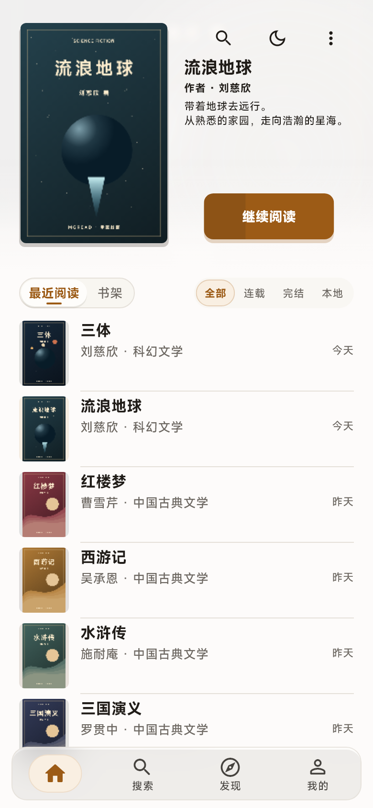
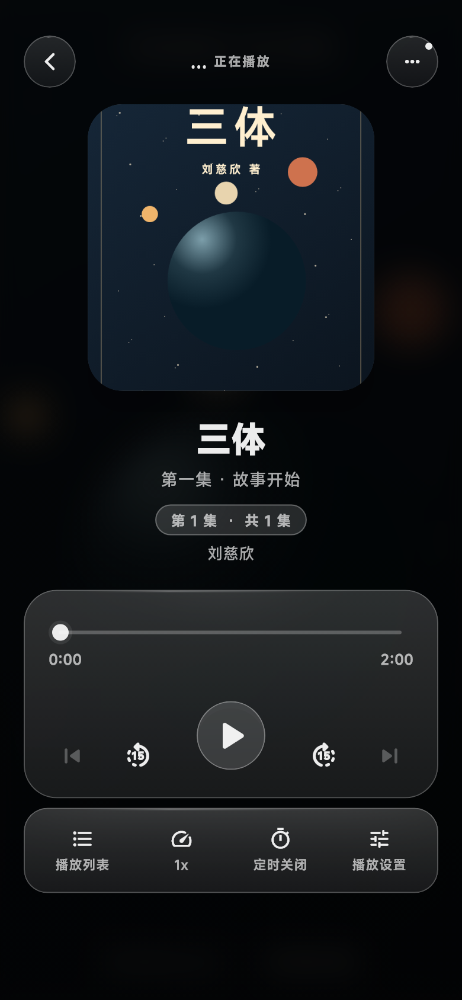
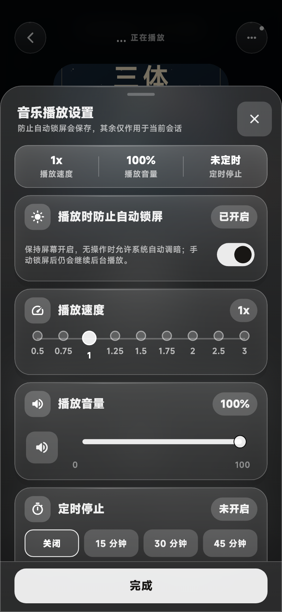
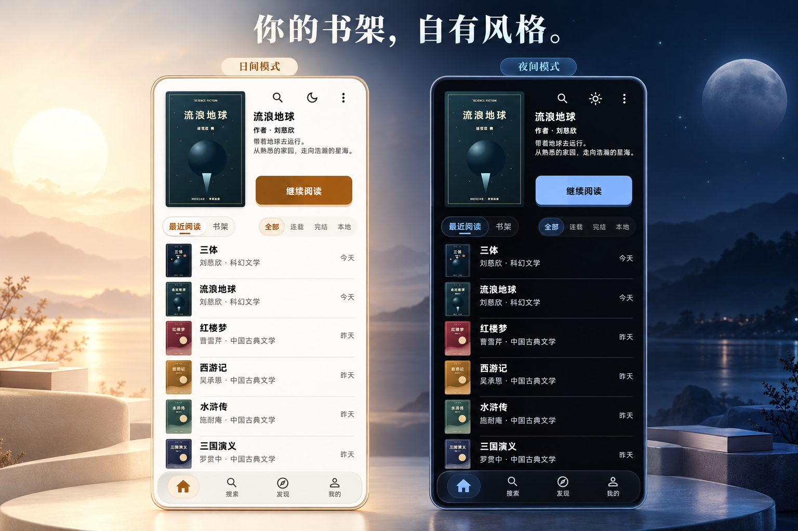

<!-- 软件宣传首页。原始截图由真实界面组件配合独立演示数据渲染；设备与场景效果图基于截图制作。 -->

# MgRead

**把小说、漫画、听书和影音，放进同一个阅读空间。**

收藏喜欢的内容，自由调整阅读方式，在手机和电脑上继续自己的故事。

**Android · Windows · macOS**

[界面预览](#先看看-mgread) · [软件功能](#从打开书架到沉浸阅读) · [下载应用](#在你的设备上开始阅读) · [上手指南](#三步开始使用)

## 先看看 MgRead

MgRead 是一款支持多种内容的阅读应用。你可以添加数据源，搜索和发现内容，把它们收藏到书架，再用对应的小说阅读器、漫画阅读器或音视频播放器打开。书架与进度保存在本地，也可以通过局域网在设备间同步。

下面展示的是 **书架、小说阅读、音频播放** 三种界面。点击图片，可查看大图。

<table>
<tr>
<th width="33%">书架 · 找到上次的故事</th>
<th width="33%">阅读 · 把空间留给文字</th>
<th width="33%">听书 · 按自己的节奏听</th>
</tr>
<tr>
<td valign="top"></td>
<td valign="top"></td>
<td valign="top"></td>
</tr>
<tr>
<td valign="top">最近阅读与书架切换，按状态筛选内容，一键继续阅读。</td>
<td valign="top">正文专注呈现，底部显示章节、进度与页码。</td>
<td valign="top">播放、拖动进度、前后跳转、倍速与定时关闭集中呈现。</td>
</tr>
</table>

原始截图由当前软件的真实界面组件渲染；书目、示意封面和播放信息使用独立演示数据，不代表应用内置这些作品。场景效果图基于截图生成，界面细节以原始截图为准。

## 从打开书架，到沉浸阅读

### 01 / 书架，收好每一种喜欢

《三体》的星海、《流浪地球》的远行，或是《红楼梦》里的草木人情——喜欢的作品，放在随时能找到的位置。

- **接着上次读**：首页展示最近阅读的作品，封面、作者与简介一目了然，点击「继续阅读」即可进入。
- **按习惯整理**：支持列表与封面卡片布局，可以在最近阅读和书架之间切换，也能按全部、连载、完结、本地筛选。
- **不止文字**：小说、漫画、音频、视频使用各自的阅读或播放界面，在同一个应用里管理和打开。

<strong>查看封面卡片布局</strong>

 

### 02 / 阅读，让排版适应你

阅读器提供 **字号、字体、间距、配色、背景和翻页方式** 设置。想把文字放大一点，换成温润的纸色，或调整翻页手感，都可以在阅读时完成。

- **多种翻页方式**：仿真、覆盖、滑动、上下翻页和无动画，按自己的习惯选择。
- **目录与书签**：快速跳到想读的章节，也可以给喜欢的位置留下书签。
- **继续阅读与章节缓存**：保留阅读进度；支持由阅读器发起章节缓存，已缓存的正文可供后续阅读。

### 03 / 听书，给双眼放个假

播放器把常用操作放在同一屏：封面与章节信息在上方，进度和播放控制在下方。通勤、散步，或睡前听一会儿，都能随手操作。

| 你想做的事 | MgRead 的操作 |
| --- | --- |
| 漏听了一句话 | 向后跳转 15 秒，或拖动进度条 |
| 想听得快一点 | 调整播放倍速 |
| 睡前听一会儿 | 设置定时关闭 |
| 换一个章节 | 打开播放列表选择章节 |
| 下次接着听 | 在设置中开启记住播放位置 |

<strong>查看倍速、音量和定时停止设置</strong>

 

### 04 / 日间与夜间，都有自己的颜色

书架提供浅色与深色外观，并可分别保存日间、夜间的主题偏好。阅读器还提供独立的正文配色和背景，让书架与读书时的样子都合你心意。

<a href=".github/readme/screenshots/shelf-light.png">查看日间原始截图</a> · <a href=".github/readme/screenshots/shelf-dark.png">查看夜间原始截图</a>

### 05 / 内容入口，由你选择

MgRead 通过数据源连接不同内容来源。你可以导入单个数据源，也可以导入合集并勾选需要的来源，然后使用搜索与发现功能寻找内容。

**安装应用 → 添加数据源 → 搜索或发现 → 收藏到书架 → 阅读或播放。**

不同来源提供的内容、搜索方式与可用功能可能不同；应用负责把阅读、播放和收藏体验集中起来。

### 06 / 手机上随手读，电脑上慢慢看

MgRead 提供 Android、Windows 和 macOS 版本。桌面界面会把书架放在居中的阅读区域，保留熟悉的封面、筛选与继续阅读入口。

在同一局域网中配对设备后，可以同步书架、进度等数据。同步时保持两端应用在前台，也可以手动发起同步。

<strong>展开查看桌面版书架</strong>

 

## 在你的设备上开始阅读

| 平台 | 选择的文件 | 下载 |
| :--- | :--- | :--- |
| **Android** | ARM64 · `.apk` | [下载 Android 版](https://github.com/lingy-Mg/mg_read/releases/latest) |
| **Windows** | x64 · `.zip` | [下载 Windows 版](https://github.com/lingy-Mg/mg_read/releases/latest) |
| **macOS** | Apple Silicon · `.zip` | [下载 macOS 版](https://github.com/lingy-Mg/mg_read/releases/latest) |

进入发布页后，在 **Assets** 中选择对应平台的文件。应用持续更新，功能以所下载版本为准。

## 三步，开始使用

**01 · 安装 MgRead**

前往 [下载页面](https://github.com/lingy-Mg/mg_read/releases/latest)，获取适合设备的安装包。

**02 · 添加数据源**

在应用的「添加数据源」中导入数据源文件。也可以到 [发布列表](https://github.com/lingy-Mg/mg_read/releases) 找到 **MgRead source collection**，下载 `mgread-sources.mgplugins`，选择「导入数据源合集」，勾选需要的来源。

**03 · 找到内容，开始体验**

启用数据源后，搜索或浏览内容，加入书架，再进入阅读器或播放器。

## 常见问题

<strong>安装后为什么还需要添加数据源？</strong>

MgRead 提供阅读、播放与收藏工具，内容来自你添加的数据源。截图中的《三体》《流浪地球》和经典名著用于界面演示，不代表安装后就能直接获取这些作品。

<strong>支持云端同步吗？</strong>

书架与进度优先保存在本地，目前不提供云端同步。可以将设备连接到同一局域网，在应用保持前台的情况下配对并同步。

<strong>遇到问题，或者想提建议？</strong>

欢迎在 [Issues](https://github.com/lingy-Mg/mg_read/issues) 留言。提供应用版本、设备平台、使用的数据源和复现步骤，会更容易定位问题。

---

### MgRead · 阅读，自由一点。

[下载应用](https://github.com/lingy-Mg/mg_read/releases/latest) · [反馈建议](https://github.com/lingy-Mg/mg_read/issues) · [参与开发](docs/development/README.md)

如果喜欢 MgRead，欢迎点亮一颗 **Star**。

内容由所选数据源及其服务提供，请在获得相应授权的前提下使用。

